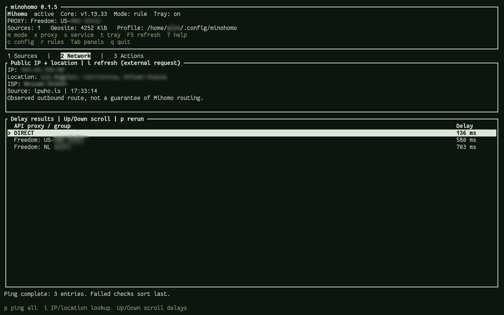

<a id="readme-top"></a>

[](https://github.com/alex-karev/minohomo/releases/latest)
[](https://github.com/alex-karev/minohomo/actions/workflows/debian.yml)
[](https://github.com/alex-karev/minohomo/issues)
[](LICENSE)

<div align="center">
  <a href="https://github.com/alex-karev/minohomo">
    
  </a>
  <h1>Minohomo</h1>
  <p>A Linux proxy client powered by Mihomo. Terminal dashboard, desktop tray, and CLI.</p>
  <p>
    <a href="https://github.com/alex-karev/minohomo/releases/latest"><strong>Download</strong></a>
    &middot;
    <a href="docs/usage.md">Documentation</a>
    &middot;
    <a href="https://github.com/alex-karev/minohomo/issues">Report a bug or request a feature</a>
  </p>
</div>

<details>
  <summary>Table of contents</summary>

- [About the project](#about-the-project)
- [Installation](#installation)
- [Quick start](#quick-start)
- [Usage](#usage)
- [Configuration](#configuration)
- [Documentation](#documentation)
- [Contributing](#contributing)
- [AI disclosure](#ai-disclosure)
- [License](#license)
- [Acknowledgments](#acknowledgments)

</details>

## About the project

<div align="center">
  <a href="src/assets/screenshot.png">
    
  </a>
</div>

Minohomo manages your proxy connections from one place. Import subscriptions or individual links, choose an outbound node, switch routing modes, test connections, and control the core without leaving your terminal. The optional desktop tray keeps everyday controls a click away.

**Features**

- **Terminal dashboard:** Sources, Network, and Actions panels, live status, searchable proxy selection, and config/rules editor shortcuts. Uses your terminal's colors.
- **Desktop tray:** switch proxies and modes, start or stop the core, and open the dashboard in your preferred terminal.
- **Managed Mihomo core:** download and update the core from the client. No separate Mihomo installation required.
- **System-wide TUN:** route traffic through Mihomo, with local HTTP and SOCKS5 listeners for apps that use an explicit proxy.
- **Source management:** named subscriptions and direct links, cached nodes, selective updates, renaming, and removal. Subscriptions refresh when you request it.
- **Network checks:** proxy delay results sorted fastest first, plus an on-demand public IP and location lookup.
- **Editable routing:** local YAML settings, DNS policy, routing rules, proxy groups, and geosite updates.
- **Full CLI:** use the same operations from scripts or a regular shell.

Supported imports include V2Ray subscriptions and VLESS, VMess, Trojan, Shadowsocks, ShadowsocksR, Hysteria, Hysteria2, TUIC, SOCKS5, HTTP, and HTTPS links. Clash YAML subscriptions and XHTTP are not supported. See [import support](docs/configuration.md#supported-imports) for details.

## Installation

### Debian / Ubuntu

Download the `.deb` for your architecture from [GitHub Releases](https://github.com/alex-karev/minohomo/releases/latest). Packages support **Debian 12 and newer**, on **amd64** and **arm64**.

```sh
# Run from the directory containing the downloaded package.
sudo apt install ./minohomo_*_amd64.deb
# On ARM64, use the *_arm64.deb package instead.
```

### Arch Linux

Install the release `.pkg.tar.zst` package:

```sh
sudo pacman -U ./minohomo-*.pkg.tar.zst
```

Or build from the repository checkout with `makepkg -si`. Release builds target **x86_64**; the PKGBUILD also supports native **aarch64** builds on Arch Linux ARM.

### NixOS

Add `minohomo.url = "github:alex-karev/minohomo";` to your flake inputs and import `minohomo.nixosModules.default` in your host's modules list. Then enable the client and core service:

```nix
services.minohomo.enable = true;
```

The module installs the client and service units. The core starts at boot once you have applied your first configuration. See the [NixOS setup example](docs/development.md#nixos).

Run Minohomo as your regular user. It asks for sudo authorization when installing the core, applying configuration, or controlling the system service. The core installs automatically when first needed. Installing the package alone does not start services or change your network.

The desktop tray needs StatusNotifier/AppIndicator support. KDE supports it directly; GNOME needs a compatible AppIndicator extension. A desktop polkit agent handles authorization for tray service controls.

For other setups, see [building from source](docs/development.md#building-from-source). The client requires Linux and systemd.

## Quick start

Open the dashboard:

```sh
minohomo
```

1. In **Sources**, press `a` to add a subscription URL or direct proxy link. Give it a name if you want.
2. Press `U` to update all sources. Minohomo installs a missing core, validates your settings, applies them, and starts the service. Expect a sudo prompt.
3. Press `x` to choose a proxy, or `m` to switch between Rule, Global, and Direct modes.
4. Open **Network** to test delays with `p` or look up your public IP with `i`.

Prefer the CLI?

```sh
minohomo add 'https://subscription.example/profile' --name Personal
minohomo update
minohomo ping
minohomo switch 'Personal: Node name'
```

Replace the example URL and node name with your own. `minohomo list --full` shows cached node names; `minohomo switch` lists the running choices.

The core keeps running after you close the dashboard. On Debian or Arch, start it at boot after the first successful update:

```sh
sudo systemctl enable minohomo.service
```

## Usage

### Terminal dashboard

| Key | Action |
| --- | --- |
| `Tab`, `1` / `2` / `3` | Switch Sources, Network, and Actions panels |
| `a`, `n`, `d` | Add, rename, or delete a source in Sources |
| `u`, `U` | Update the selected source or all sources |
| `m`, `x` | Choose the running mode or proxy |
| `s`, `t` | Control the core service or toggle the tray |
| `p`, `i` | Test proxy delays or look up public IP/location |
| `c`, `r` | Edit settings or routing rules |
| `?`, `q` | Show keyboard help or quit |

The **Actions** panel also includes core updates, geosite downloads, and **Apply cached sources**. Use the cached action after editing settings or rules to apply changes without refreshing subscriptions.

### Desktop tray

Use the tray to select a proxy, change mode, start/stop/restart the core, or open the dashboard in a new terminal.

```sh
minohomo tray enable
minohomo tray disable
```

Set `default_terminal` in your settings to choose the terminal opened by the tray. Leave it `null` to use the system default.

### Common CLI commands

```sh
minohomo list --full                # Sources and cached nodes
minohomo update Personal            # Refresh one saved source
minohomo update --no-sync           # Apply cached sources and local edits
minohomo rename Personal Work       # Rename a saved source
minohomo mode rule                  # Rule, Global, or Direct mode
minohomo start                      # Start the core service
minohomo stop                       # Stop the core service
minohomo restart                    # Restart the core service
minohomo core version               # Installed version, or Not installed
minohomo core update                # Download and install the latest core
minohomo geosite update             # Update geosite data and reload
```

See the [usage guide](docs/usage.md) for the complete command reference and keyboard controls. Each command also accepts `--help`.

## Configuration

Minohomo creates its settings on first use:

- **`~/.config/minohomo/config.yaml`**: client preferences, core download URLs, TUN, DNS, listeners, and proxy groups.
- **`~/.config/minohomo/rules.yaml`**: routing rules and optional rule providers.

Edit them with `c` and `r` in the dashboard, then choose **Apply cached sources**, or run:

```sh
minohomo update --no-sync
```

By default, TUN is enabled, local/private and Tailscale networks bypass it, and local, Chinese, and Russian domains use DIRECT. Other traffic uses your selected proxy. The local HTTP/SOCKS5 listener is **`127.0.0.1:7897`**. Review the [default network policy](docs/configuration.md#default-network-behavior) before relying on it.

Use `--config-dir /absolute/path` for a separate source/settings profile. Profiles share the system core and runtime service; they are not independent simultaneous tunnels.

See the [configuration guide](docs/configuration.md) and the commented [settings](defaults/config.yaml) and [rules](defaults/rules.yaml) templates.

## Documentation

| Guide | Contents |
| --- | --- |
| [Usage](docs/usage.md) | Dashboard controls, CLI reference, source names, tray, and geosite management |
| [Configuration](docs/configuration.md) | Settings, routing policy, mirrors, and supported imports |
| [Troubleshooting](docs/troubleshooting.md) | Network diagnostics, core recovery, service errors, and desktop issues |
| [Implementation](docs/implementation.md) | Runtime files, update/apply flow, privileges, API access, and background services |
| [Development](docs/development.md) | Source builds, Debian packaging, and checks |

Subscription links and config files can contain credentials. Do not share `list`, `dump`, or `controller` output publicly. The optional IP lookup contacts [ipwho.is](https://ipwho.is/) only when requested; it reports the observed outbound route, not proof that traffic passed through Mihomo.

## Contributing

Bug reports, feature requests, and focused pull requests are welcome. Open an [issue](https://github.com/alex-karev/minohomo/issues) with steps to reproduce and sanitized logs. For code changes, describe what changed and how you tested it. See the [development guide](docs/development.md).

## AI disclosure

This project was built with AI-generated code under the author's direction. The author has not audited the generated code. Minohomo downloads executable code and changes system networking through privileged operations. Use it at your own risk; no warranty.

## License

Distributed under **GPL-3.0-only**. See [LICENSE](LICENSE).

## Acknowledgments

- [Mihomo](https://github.com/MetaCubeX/mihomo) for the proxy core.
- [Ratatui](https://ratatui.rs/) for the terminal UI.
- [ksni](https://github.com/iovxw/ksni) for the desktop tray.
- [Best-README-Template](https://github.com/othneildrew/Best-README-Template) for the README structure.

<p align="right">(<a href="#readme-top">back to top</a>)</p>
